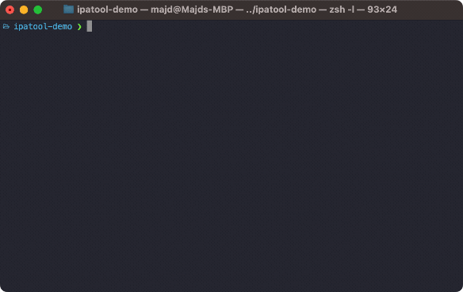

<p align="center">
  <a href="https://GitHub.com/majd/ipatool/releases/"></a>
  <a href="https://github.com/majd/ipatool/blob/main/LICENSE"></a>
  <a href="https://github.com/sponsors/majd"></a>
</p>

<p align="center">
  <code>ipatool</code> is a command line tool that allows you to search for iOS, iPadOS, tvOS, watchOS, visionOS, and macOS apps on the <a href="https://apps.apple.com">App Store</a>, and download <code>.ipa</code> or macOS <code>.pkg</code> app packages.
</p>

<p align="center">
  
</p>

## Requirements

- A supported operating system (macOS, Linux, Windows or iOS).
- An Apple Account already configured to use the App Store.

## Installation

### Linux and Windows

You can grab the latest version of `ipatool` from [GitHub releases](https://github.com/majd/ipatool/releases).

### macOS

You can install `ipatool` using [Homebrew](https://brew.sh).

```shell
$ brew install ipatool
```

## Usage

To get started, run the following command.

```text
$ ipatool --help
A cli tool for interacting with Apple's ipa files

Usage:
  ipatool [command]

Available Commands:
  auth                 Authenticate with the App Store
  completion           Generate the autocompletion script for the specified shell
  download             Download iOS, iPadOS, tvOS, watchOS, visionOS, and macOS app packages from the App Store
  fairplay-doctor      Diagnose FairPlay build, enrollment, SINF, and model compatibility
  fairplay-decrypt     Decrypt a personalized IPA using the portable FairPlay pipeline
  fairplay-enroll      Collect and recover private native FairPlay enrollment
  get-version-metadata Retrieves the metadata for a specific version of an app
  help                 Help about any command
  list-purchases       List apps owned by the authenticated App Store account
  list-versions        List the available versions of an App Store app
  mcp                  Serve App Store tools over MCP using stdio
  purchase             Obtain a license for the app from the App Store
  search               Search for iOS, iPadOS, tvOS, watchOS, visionOS, and macOS apps available on the App Store

Flags:
      --format format                sets output format for command; can be 'text', 'json' (default text)
  -h, --help                         help for ipatool
      --keychain-passphrase string   passphrase for unlocking keychain
      --non-interactive              run in non-interactive session
      --verbose                      enables verbose logs
  -v, --version                      version for ipatool

Use "ipatool [command] --help" for more information about a command.
```

**Note:** the tool runs in interactive mode by default. Use the `--non-interactive` flag
if running in an automated environment.

### FairPlay decryption

> **Experimental:** Current-SINF decryption requires a private enrollment
> model generated for the matching account profile and SINF. No recovered
> enrollment keys are embedded in this repository or binary.

#### Current support

Both the modern enrollment layout and the preserved older
`bbbbbbbb:00000005` Mac enrollment are now supported on the checked FairPlay
profile. The older control was recovered entirely from Mac SIDB, license, and
hardware state; no iPhone/iOS 16 secret is used. Other migrated or legacy
layouts remain unproven and fail closed.

| Host/FairPlay profile | Recovery status | End-to-end IPA status |
| --- | --- | --- |
| macOS 27.0.1 `26A434` with arm64e fairplayd SHA-256 `1e58d37e…e4ea1784` | Supported by the pure-Go `macos26a428` profile | Revalidated with per-page offsets across modern and older-account IPAs |
| arm64e fairplayd SHA-256 `f68e4407…4964439d` (`26B118` profile) | Supported through the embedded 26A428 compatibility path | Revalidated with an external account: 39 images and 10,080 pages |
| Any other arm64e fairplayd hash using the current SINF/state contract | Automatic portable compatibility attempt | Unverified until recovery validates the complete SINF and matching IPA |

The fairplayd arm64e slice hash records provenance and identifies the builds
that have independent controls; it is no longer an allowlist. The macOS host
build and internal FairPlay binary profile do not always have the same label:
the validated macOS `26A434` installation contains the checked `26A428`
fairplayd slice. For an unknown hash, `fairplay-doctor` reports a portable
recovery candidate. Recovery uses the captured state as runtime data and
publishes no model unless the complete SINF and matching IPA pass validation.
It first uses the smallest proven license/state set, then retries with all
captured SINF/SUPF, shared-state, and ADI variants when that contract fails.

Before executing the evaluator, recovery normalizes the capture into the
versioned `macos-current-sinf-v1` contract. It validates the installed and
target SINF selectors, parses every SUPF architecture/page table, classifies
the SIDB envelope, verifies the six-byte hardware identity, and fingerprints
the resulting metadata deterministically. The private recovery directory keeps
this evidence as `canonical-input.json`; it contains hashes and geometry, not
raw SIDB, hardware, or key bytes.

`fairplay-enroll collect` also records a normalized ARM64 structural profile.
The profiler ignores registers, immediates, and branch destinations when
matching the protected enrollment anchors. It combines Mach-O function starts
with authenticated dispatch-table roots recovered from dyld fixups, so rebased
or re-randomized builds can be recognized without a hash entry. Structural
matches are evidence only; they never bypass the SINF and IPA promotion gate.
A standalone inspection is available from the source tree:

```shell
go run ./tools/fairplay-profile --binary /path/to/fairplayd
```

The experimental `fairplay-decrypt` command currently runs only on macOS and
Linux because it enforces Unix private-file permissions. The standalone Go
recovery helper can be cross-compiled for Windows, but the final ipatool
decryption command intentionally rejects Windows for now.

#### Quick usage with an existing model

Decrypting an existing personalized IPA is offline once the matching model is
available; it does not require an App Store login or network connection:

```shell
chmod 600 fairplay-enrollment.bin

ipatool fairplay-decrypt \
  --input App.ipa \
  --model fairplay-enrollment.bin \
  --output App.decrypted.ipa \
  --report App.decrypted.json
```

To download another personalized IPA, first authenticate the same Apple
Account whose enrollment produced the model:

```shell
ipatool auth login
```

Then purchase when necessary, download, and decrypt in one command:

```shell
ipatool download \
  --app-id APP_ID \
  --purchase \
  --output App.ipa \
  --fairplay-decrypt \
  --fairplay-model fairplay-enrollment.bin \
  --fairplay-output App.decrypted.ipa \
  --fairplay-report App.decrypted.json
```

For scripts, request machine-readable command output while keeping the private
decryption report in its own file:

```shell
ipatool --format json fairplay-decrypt \
  --input App.ipa \
  --model fairplay-enrollment.bin \
  --report App.decrypted.json
```

The model may be either one `.bin` file or a private directory containing up
to 256 selector-bound `.bin` models. Directory mode is useful for several
accounts or multiple model layouts for one selector. ipatool first filters by
the IPA selector, then requires exactly one model to decode and validate the
complete SINF. Zero valid models and multiple valid models both fail closed:

```shell
mkdir -m 700 fairplay-models
install -m 600 Account-A.bin fairplay-models/
install -m 600 Account-B.bin fairplay-models/

ipatool fairplay-decrypt \
  --input App.ipa \
  --model fairplay-models
```

Model directories must be mode `0700` or stricter, and every model must be
mode `0600` or stricter. Symlinks are rejected. Files without a `.bin`
extension are ignored.
`fairplay-doctor` reports general preflight readiness as `ready`; its separate
`decrypt_ready` field becomes true only when a supplied model validates the
complete IPA SINF.

Unless explicit paths are supplied, `App.ipa` produces
`App.decrypted.ipa` and `App.decrypted.json` beside the input. Existing output
or report files are never replaced unless `--force` is passed (or
`--fairplay-force` on `download`). A successful run still leaves the original
encrypted IPA unchanged.

Common failures are intentional fail-closed checks:

- `requires a private enrollment model`: pass `--model FILE` or
  `--model DIRECTORY`;
- `no model that decodes SINF`: the selector matched, but the enrollment model
  did not validate the complete SINF;
- `portable-validation-required`: the build is not independently verified;
  run recovery with a matching IPA and accept only a fully validated result;
- a permission error: remove group/other access with `chmod 600 MODEL` and
  `chmod 700 MODEL_DIRECTORY`;
- an existing-output error: choose another path or explicitly pass `--force`.

#### What the matching enrollment contains

The checked-in Go files and sanitized models contain build-specific control
flow and fixed tables, but no account data. Private recovery inputs come from
the capture bundle. They are specific to the combination of:

- exact fairplayd binary;
- local App Store enrollment state;
- Apple Account profile and SINF selector.

In practice, use a fresh Apple Account on the supported Mac, accept the App
Store terms, install a free app through the native App Store, and open it once.
An ipatool-only purchase or download does not create the required native Mac
enrollment. The pure-Go recovery consumes the captured SINF/SUPFs, SIDB,
executable, and hardware identity and packages the result as
`fairplay-enrollment.bin`. It does not attach to fairplayd, execute Apple code,
or require a private checkpoint. Recovery still requires the complete capture
bundle; an IPA or Apple Account password alone is insufficient.

The resulting `fairplay-enrollment.bin` is normally reusable for IPAs
personalized to the same account enrollment and selector. Generate a new one
when the account is re-enrolled, the SINF selector changes, or recovery must be
performed from a different fairplayd build. Never share the recovered model;
it contains private account-derived key material.

#### Enrollment, recovery, and decryption workflow

1. On the supported Mac, confirm the exact build:

   ```shell
   sw_vers -productVersion
   sw_vers -buildVersion
   ```

   Continue only with a build listed as supported above. A close build number
   is not compatible.

2. Create a new Apple Account. Sign in with it in the native Mac App Store and
   complete all first-use prompts and Store terms. Do not reuse an older or
   migrated account for the currently supported path.

3. In the native App Store, obtain and install a free app. Launch that installed
   app once and wait for it to finish opening. This causes macOS to create the
   local FairPlay enrollment/`SC Info` state and gives the app a SINF tied to
   that enrollment. Merely purchasing or downloading the IPA with ipatool does
   not perform this step.

4. Keep the account signed in and do not delete `SC Info`, reinstall macOS, or
   reset the App Store state. Obtain an encrypted IPA personalized to the same
   Apple Account. Then collect the installed app, exact fairplayd slice,
   hardware identity, SC Info/ADI state, SINF/SUPFs, and IPA into one private
   bundle. Reading `/private/var/db/fpsd` normally requires `sudo`; the command
   restores ownership to the invoking user when run through sudo:

   ```shell
   sudo ipatool fairplay-enroll collect \
     --app /Applications/App.app \
     --ipa /private/path/App.ipa \
     --output /private/path/App.capture
   ```

5. Inspect the bundle before recovery. The report contains hashes and geometry,
   not passwords or plaintext keys:

   ```shell
   ipatool fairplay-doctor \
     --capture /private/path/App.capture \
     --report /private/path/App.doctor.json
   ```

6. From the ipatool source tree, install the Go toolchain, then run the pure-Go
   recovery pipeline:

   ```shell
   ipatool fairplay-enroll recover \
     --capture /private/path/App.capture \
     --output /private/path/App.recovery
   ```

   This runs the build-specific Go path, writes `fairplay-enrollment.bin`,
   decrypts the captured IPA, verifies every encrypted Mach-O and available
   CodeDirectory page hash, and structurally audits executable plaintext pages.
   A candidate model is not promoted unless complete IPA validation succeeds.

7. Store the recovered model privately and reuse it for another IPA from the
   same enrollment and selector:

   ```shell
   chmod 600 /private/path/App.recovery/fairplay-enrollment.bin

   ipatool fairplay-decrypt \
     --input AnotherApp.ipa \
     --model /private/path/App.recovery/fairplay-enrollment.bin
   ```

   Or decrypt immediately after a same-account download:

   ```shell
   ipatool download \
     --app-id APP_ID \
     --purchase \
     --fairplay-decrypt \
     --fairplay-model /private/path/App.recovery/fairplay-enrollment.bin
   ```

8. Check the private JSON report. Success requires every previously encrypted
   image to have `cryptid_after: 0`, all expected pages to be processed, and
   every listed CodeDirectory to have `matched_slots == slot_count`. The output
   is an analysis IPA and still needs recursive code signing before it can be
   installed. CodeDirectory hashes authenticate the encrypted source; the
   ARM64 audits are the independent structural check on decrypted plaintext.
   `audited_page_index` identifies the executable page represented by the
   legacy `first_page_*` report fields when code starts after page zero.

`fairplay-decrypt` decrypts a personalized IPA using an explicit private model.
After local model recovery, no device state, Wine, Unicorn, or runtime hardware
call is needed:

```shell
ipatool fairplay-decrypt \
  --input App.ipa \
  --model fairplay-enrollment.bin
```

The same experimental option is available as `--fairplay-model` when
decrypting directly after `ipatool download`. Model files contain private key
material and must be readable only by their owner; ipatool rejects group- or
world-readable files. Never commit or publish a model. The companion tool at
`tools/fairplay-recovery` recovers the AES model for an exact supported
fairplayd build. Private enrollment material stays outside this repository.

Pass `--fairplay-decrypt` to `ipatool download` to decrypt immediately after
download and SINF replication. The decoder validates the complete decrypted
`key `/`iviv`/`tmpr`/`righ`/`name` atom geometry and fails closed when the SINF
does not match the selected model. Inputs are never overwritten; outputs and
private reports default beside the source IPA. A profile mismatch reports the
selected profile, SINF selector, SINF SHA-256, and private-payload size/hash,
then fails closed without creating an output IPA. These diagnostics contain no
plaintext key. The decrypted analysis IPA must be recursively re-signed before
installation.

The build-specific recovery implementation is included under
`tools/fairplay-recovery`. It is pure Go and follows the natural enrollment
path through current-SINF key construction; it does not require Swift, Metal,
DarkPhoenix, Python, Unicorn, Apple binaries, or a private oracle checkpoint.

The newer 26A428 research components for the state-slot transform, frame
builder, and SIDB block consumer now use sanitized embedded build models. The
SIDB component accepts its private 16-byte enrollment frame only at runtime;
the embedded model contains no retained account frame or recovered key. The
parser/file bootstrap and complete source loop are now pure Go too: given a
private account-entry model and the captured executable, SINF/SUPFs, SIDB, and
hardware address, they reproduce the native 192/224-byte source exactly.

The account-entry constructor is now pure Go as well. A sanitized embedded
pre-license model accepts the captured executable path, SINF/SUPFs, SIDB,
executable, and hardware address at runtime and reproduces the native
192/224-byte source for both modern controls and the preserved older-account
control. The older source matches without using the iPhone/iOS 16 secret.

`fairplay-enroll recover` now uses this Go path by default, generates the
selector-bound model, decrypts the captured IPA, and promotes the candidate
only after complete validation. Passing `--script` explicitly selects the
legacy Python research pipeline. The final `fairplay-enrollment.bin` remains
private in every workflow.

### FairPlay enrollment diagnostics

This diagnostic branch can preserve the transaction-bound FairPlay inputs from
one successful `ent/download` request:

```shell
ipatool download \
  --app-id 333903271 \
  --external-version-id 893310510 \
  --output X-12.36.ipa \
  --fairplay-capture-dir X-12.36-fairplay-capture
```

The capture directory must not already exist. It is created with private
permissions and contains `kbsync.bin`, `keybag.bin`, the returned SINF, and a
`receipt.json` containing selectors, byte lengths, and SHA-256 hashes. The
KBSync and keybag are taken from the same Store transaction. Passwords, 2FA
codes, cookies, and Store authentication tokens are not written.

The captured blobs are personalized material. Share the directory privately;
do not attach it to a public issue.

`--fairplay-capture-dir` is a Store transaction diagnostic. It does not create
the native fairplayd checkpoint or `fairplay-enrollment.bin`, and it cannot
replace the enrollment/recovery workflow above.

### MCP tools

Run `ipatool auth login` in a terminal, then configure your MCP client to launch the stdio server:

```json
{
  "mcpServers": {
    "ipatool": {
      "command": "ipatool",
      "args": ["mcp"]
    }
  }
}
```

## Compiling

The tool can be compiled using the Go toolchain.

```shell
$ go build -o ipatool
```

Unit tests can be executed with the following commands.

```shell
$ go generate ./...
$ go test -v ./...
```

## License

ipatool is released under the [MIT license](https://github.com/majd/ipatool/blob/main/LICENSE).
